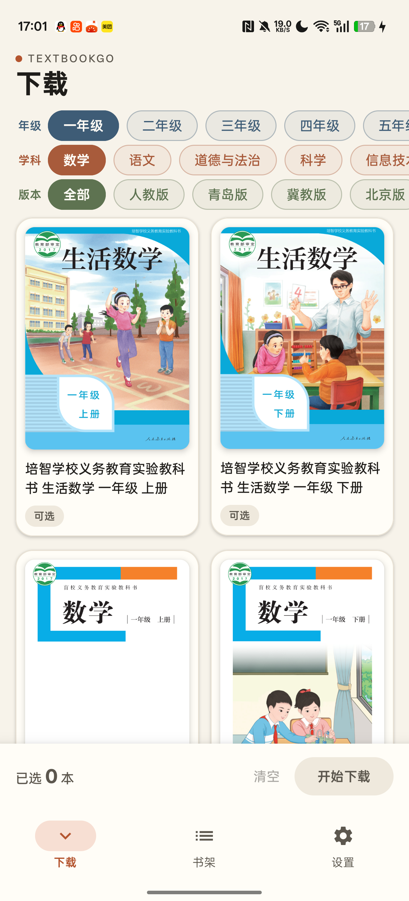
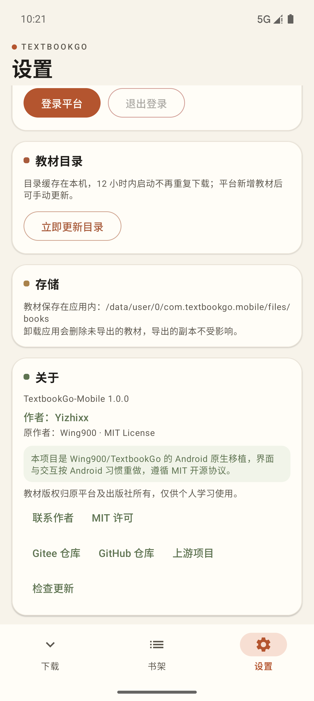
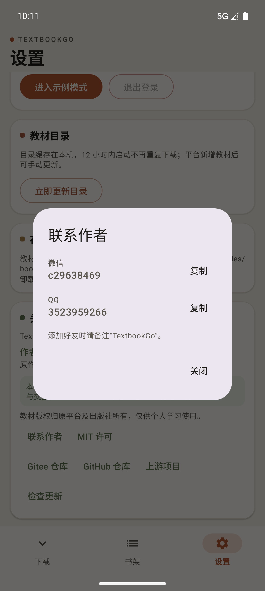
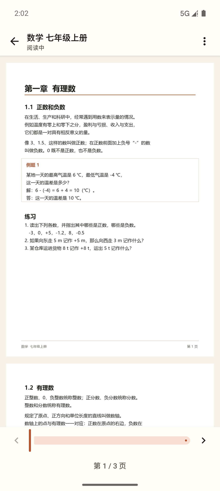
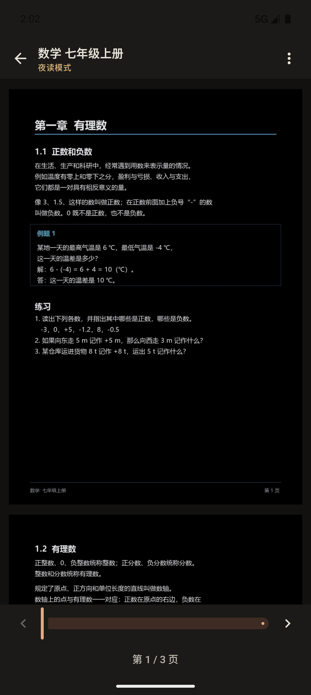

# TextbookGo-Mobile

**TextbookGo 的 Android 原生移植** · Kotlin + Jetpack Compose · Android 8.0+

把国家智慧教育平台的教材下载体验搬到手机上：登录自己的账号，按年级 / 学科 / 版本选书，批量下载、断点续传，下载完成后进书架，应用内直接阅读 PDF，也支持分享和导出。

[下载 APK](https://github.com/AlsoLate/TextbookGo-Mobile/releases/latest) · [Gitee 镜像](https://gitee.com/yizhixixi/TextbookGo-Mobile) · [更新清单](update/latest.json)

## 截图



*年级 / 学科 / 版本三级筛选，2022 年修订版自动置顶并加标签*



*关于页：作者、原作者 MIT 归属、仓库入口与检查更新*



*微信 / QQ 一键复制*



*应用内 PDF 阅读器：连续滚动、双指缩放、滑块 / 页码跳转与阅读进度记忆*



*夜读模式：纸面反相 + 暗色工具栏，关灯后也能看*

## 功能

- **登录**：应用内 WebView 打开平台登录页，读取登录凭据；支持记住登录、401/403 自动标记过期
- **选书**：年级 / 学科 / 版本三级筛选，每个年级记住上次的学科和版本；书名去掉“义务教育教科书”前缀，2022 年修订版以标签置顶
- **目录**：真实分片并发加载，本地缓存 12 小时，断网也能浏览已缓存目录
- **下载**：全局 3 并发、流式写入、主备链接回退、暂停 / 继续 / 重试 / 取消、大小与 MD5 校验
- **断点续传**：Range 续传，200 自动重下，416 完成判断
- **书架**：平台封面、PDF 首页缩略图兜底、大小 / 日期、打开（应用内阅读）、分享、导出（SAF）、删除确认
- **阅读**：应用内 PDF 阅读器，连续滚动、双指缩放 / 双击放大、滑块与页码跳转、夜读反相、自动记住每本书的页码、阅读时屏幕常亮
- **任务**：下载任务直接展示在书架顶部，完成后自动收起
- **外观**：跟随系统 / 浅色 / 深色三档，晨光与暗色两套完整配色
- **更新**：启动时检查新版本，24 小时节流；设置页可手动检查，支持跳过版本与强制更新

## 下载安装

- 系统要求：**Android 8.0（API 26）及以上**
- 安装包：到 [Releases](https://github.com/AlsoLate/TextbookGo-Mobile/releases/latest) 下载 `TextbookGo-Mobile-1.1.0.apk`
- 首次安装需在系统设置里允许浏览器 / 文件管理器“安装未知应用”
- 后续版本使用同一签名，可直接覆盖安装，书架与登录状态保留

> 国内网络建议优先从 [Gitee](https://gitee.com/yizhixixi/TextbookGo-Mobile/releases) 下载，GitHub 作为备用。

## 从源码构建

环境：JDK 21、Android SDK（compileSdk 36）、Gradle Wrapper 自带。

```bash
cd android
./gradlew :app:assembleDebug        # 示例数据，开发调试
./gradlew :app:assembleVerify       # 真实平台 + 调试签名，真机验收
./gradlew :app:assembleRelease      # 正式包
```

- `release` 需要 `android/keystore.properties` 指向签名证书；没有该文件时构建为未签名包
- `keystore.properties` 与 `keystore/` 已在 `.gitignore` 中，不会进入仓库
- 发布签名必须长期保存，换签名会导致老用户无法覆盖升级

## 项目结构

```text
android/
  core/       纯 Kotlin 领域层：目录规则、筛选/选择集、下载状态机、
              断点续传、更新策略、URL 白名单等（独立 JVM 测试）
  testing/    共享内存假实现，供 UI 测试与预览使用
  app/        Compose 客户端、数据层、前台下载服务、更新检查
    src/debug/    示例数据（正式包不包含）
    src/verify/   真实平台 + 调试签名，用于真机验收
    src/release/  正式发布
docs/android/ 需求、技术设计、实施计划、真机验收与更新机制文档
```

## 更新机制

App 读取 Gitee 仓库里的 `update/latest.json`（contents API，避免 raw 缓存），失败时自动回退到本仓库的同一份清单。清单包含 `versionCode`、`versionName`、APK 地址、SHA-256 和更新说明，客户端只做提示与跳转下载，不静默安装。

## 许可与致谢

- 上游项目：[Wing900/TextbookGo](https://github.com/Wing900/TextbookGo)，MIT License，Copyright (c) 2026 Wing900
- Android 移植：Yizhixx
- 本项目同样以 MIT License 发布，完整许可证见 [LICENSE](LICENSE)；App 内“关于 → MIT 许可”也可查看

## 联系作者

- 微信：`c29638469`
- QQ：`3523959266`

添加好友请备注“TextbookGo”。

## 免责声明

本项目仅供个人学习与教学研究使用。教材版权归国家智慧教育公共服务平台及相关出版社所有，请勿用于商业用途或再分发；使用本项目即表示同意遵守平台相关服务条款。
