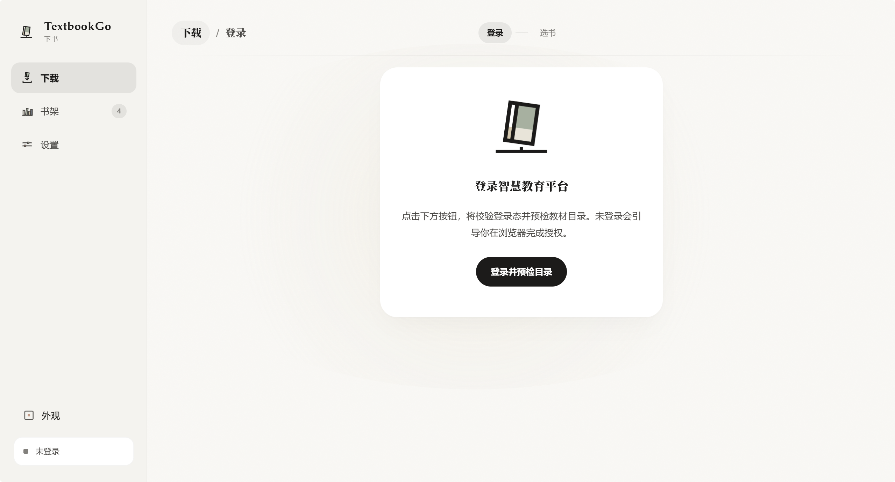
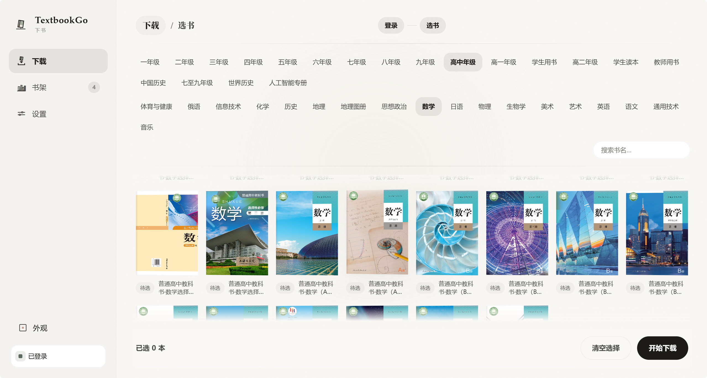
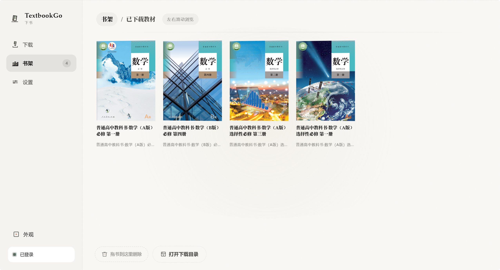

<div align="center">
  
  <h1>TextbookGo</h1>
  <p><strong>国家智慧教育平台教材下载工具</strong></p>
  <p>自动登录、交互选书、批量下载 PDF，用更轻量的方式把教材下载这件事做得省心一点。</p>
  <p>
    <a href="https://github.com/Wing900/TextbookGo/releases">下载 Releases</a> ·
    <span>Windows / macOS / Linux</span> ·
    <span>网页版开箱即用</span>
  </p>
</div>

## 简介

`TextbookGo` 是一个面向普通用户的教材下载工具。运行后会自动打开浏览器完成登录，再按年级、学科、教材名逐步选择需要的教材，最后并发下载为 PDF。

## 界面预览

<div align="center">
  
  <br/><br/>
  
  <br/><br/>
  
</div>

## 特点

- **小白开箱即用** — 下载即用，自动打开浏览器登录，无需配环境变量、无需手动复制 Token
- **内存极简** — 流式下载 + 32KB 固定缓冲区，不将 PDF 整体加载到内存，理论上可处理任意大小文件
- **跨平台** — Windows 10/11 + Windows 7 SP1 兼容轨 / macOS / Linux 全支持
- **断点续感知** — 已下载的教材自动跳过，不重复下载
- **目录直达** — 书架页一键打开下载目录
- **发布更瘦** — 构建默认精简符号与路径信息，分发体积更小

## 教程

### 1. 下载

从 [Releases](https://github.com/Wing900/TextbookGo/releases) 下载对应系统的可执行文件或压缩包。

| 文件 | 平台 |
|------|------|
| `TextbookGo-windows-amd64.exe` | Windows 10/11 64位 |
| `TextbookGo-windows7-amd64.exe` | Windows 7 SP1 / 8.x 64位（兼容轨） |
| `TextbookGo-darwin-amd64` | macOS Intel |
| `TextbookGo-darwin-arm64` | macOS Apple Silicon |
| `TextbookGo-linux-amd64` | Linux 64位 |

### 2. 运行

直接双击运行，浏览器会自动打开界面（默认 http://127.0.0.1:8790，端口被占自动顺延至 8800）：

```bash
# 下载到程序所在目录下的 books/
TextbookGo.exe

# 或指定输出目录
TextbookGo.exe -out D:\我的教材
```

### 3. 登录

点击「登录并预检目录」→ 程序打开 Chrome 浏览器 → 在国家智慧教育平台登录您的账号 → 登录成功后自动获取 Token，无需手动操作。

### 4. 选书与下载

选年级 → 学科 → 教材（支持多选），点「开始下载」自动切到书架，悬浮面板实时显示每本进度，下载完成一本书架即多一本。书架页可一键打开下载目录。

### 5. 书签（可选）

如需自动生成 PDF 书签（目录），安装 [pdfcpu](https://github.com/pdfcpu/pdfcpu) 后放在 `PATH` 即可：

```bash
go install github.com/pdfcpu/pdfcpu/cmd/pdfcpu@latest
```

## 开发打包

Windows 分发包会使用仓库根目录的 `logo.jpg` 自动生成程序图标，并将图标嵌入 `TextbookGo.exe`：

```powershell
powershell -ExecutionPolicy Bypass -File .\scripts\build-windows.ps1
```

也可以直接执行：

```bash
make package-windows
```

产物输出到 `dist/`：

- `dist/TextbookGo-windows-amd64/TextbookGo.exe`
- `dist/TextbookGo-windows-amd64.zip`

如需一次性生成 Windows / macOS / Linux 的分发包：

```bash
make package-all
```

说明：

- `bin/` 保存最新构建出来的各平台二进制
- `dist/` 保存可直接分发的打包产物
- Windows 的 `bin/TextbookGo-windows-amd64.exe` 会同步为带 logo 的打包版本

## 网页版「下书」

立体主义网页界面（前端 + JSON API + SSE 下载进度），作为唯一入口。

```bash
mise run serve          # 若已安装 mise
go run ./cmd/boooookdown-web          # 直接运行（默认 127.0.0.1:8790）
go run ./cmd/boooookdown-web -addr 127.0.0.1:9000 -out ./books
```

浏览器打开打印的地址即可使用。前端只通过 `/api/*` 与后端通信，静态资源由 Go 二进制 `go:embed` 内嵌，单文件分发。

## 免责声明

本项目仅供个人学习与教学研究使用。所下载教材的版权归属国家智慧教育公共服务平台及相关出版社，请勿用于商业用途或再分发。使用本项目即表示同意遵守平台相关服务条款。

## 许可

[MIT](./LICENSE) © 2026 Wing900
